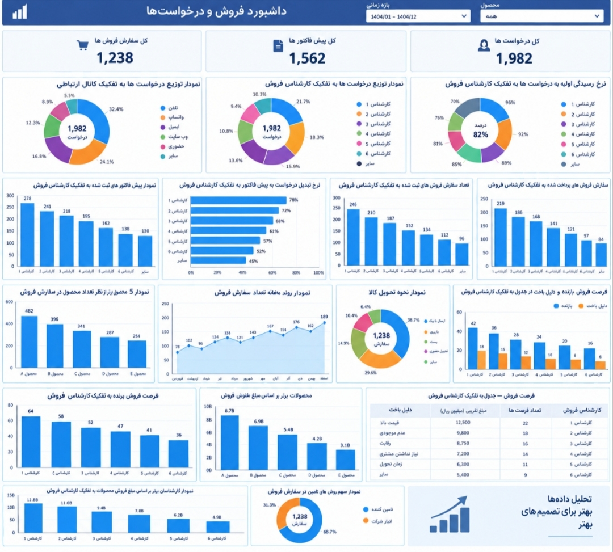

# داشبورد تحلیلی فروش | Sales Analytics Dashboard

این پروژه با هدف تحلیل عملکرد فروش و پایش شاخص‌های کلیدی فروش طراحی شده است.

## 📊 Dashboard Preview

## 📌 شاخص‌ها و تحلیل‌های داشبورد

- تعداد کل درخواست‌های فروش
- تعداد کل پیش‌فاکتورها
- تعداد کل سفارش‌های فروش
- توزیع درخواست‌ها به تفکیک کانال ارتباطی
- توزیع درخواست‌ها به تفکیک کارشناس فروش
- نرخ رسیدگی اولیه به درخواست‌ها
- پیش‌فاکتورهای ثبت‌شده به تفکیک کارشناس فروش
- نرخ تبدیل درخواست به پیش‌فاکتور
- تعداد سفارش‌های فروش به تفکیک کارشناس فروش
- سفارش‌های فروش پرداخت‌شده
- ۵ محصول برتر از نظر تعداد
- روند ماهانه سفارش‌های فروش
- نحوه تحویل کالا
- تحلیل فرصت‌های فروش برنده و دلایل باخت
- محصولات برتر بر اساس مبلغ فروش
- کارشناسان برتر بر اساس مبلغ فروش
- سهم روش‌های تأمین سفارش

## 🛠 Tools & Technologies

- Power BI
- SQL
- Data Analysis
- Data Visualization
- KPI Design
- CRM Data Analysis

## ℹ️ Note

اطلاعات و اعداد نمایش‌داده‌شده در این داشبورد نمونه بوده و صرفاً برای نمایش مهارت‌های تحلیل داده و طراحی داشبورد استفاده شده‌اند.
